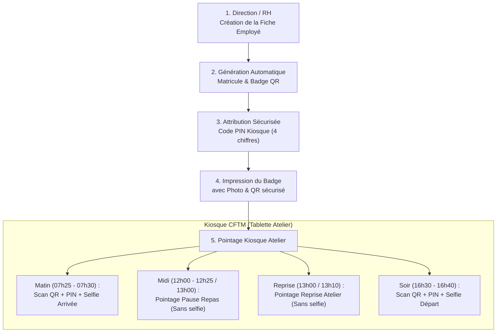

# Guide Officiel : Attribution des Accès Travailleurs, Badges QR & Code PIN au CFTM

> **Centre de Formation Technique Menuiserie (CFTM) — Bénédictins Mont Fébé**  
> Document d'exploitation et de formation destiné à la Direction, au Chef d'Atelier et aux Magasiniers.

---

## 1. Vue d'ensemble du Cycle d'Enrôlement et d'Accès

Le système CFTM garantit la traçabilité complète de chaque travailleur tout en maintenant une fluidité maximale lors des pointages quotidiens (présences et dotations outillage).

---

## 2. Procédure Étape par Étape

### Étape 1 : Création de la Fiche Travailleur
1. Rendez-vous dans le menu latéral gauche : **Équipe & Présences** → **Travailleurs**.
2. Cliquez sur le bouton vert **`+ Nouveau Travailleur`**.
3. Renseignez obligatoirement :
   - **Nom complet** (Ex: *M. AHANGA EMARAM Sylvain*)
   - **Rôle / Poste** (*Technicien Menuisier*, *Vigile*, *Coursier*, *Responsable Livraisons*, *Apprenti*, etc.)
   - **Atelier / Affectation principale** (*Magasin Léo*, *Cabine Vernissage*, *Atelier Central*)
   - **Photo d'identité** (importée ou capturée par caméra directe)

### Étape 2 : Attribution du Badge QR Code
- Dès l'enregistrement, un **matricule unique** (ex: `EMP-0042`) et un **QR Code chiffré** sont automatiquement générés.
- Cliquez sur l'icône **Badge** pour prévisualiser et imprimer le badge au format carte PVC ou plastifiée.
- Le QR code contient le token chiffré du travailleur ainsi que sa signature de vérification hors-ligne.

### Étape 3 : Définition du Code PIN Personnel (4 chiffres)
1. Sur la fiche de l'employé, cliquez sur le bouton **`Définir / Modifier le Code PIN`**.
2. Saisissez un code confidentiel à **4 chiffres** (ex: `1234`).
3. Remettez le code en main propre au travailleur.
4. *Règle de sécurité :* Le code PIN protège contre l'utilisation frauduleuse d'un badge égaré.

### Étape 4 : Déploiement de la Servante / Établi (Optionnel)
- Si le travailleur est un ouvrier d'atelier titulaire d'un poste, associez-lui son **Établi** (de `Établi 1` à `Établi 17`) dans le module **Matériel & Machines**.
- La servante complète (22 outils standards) lui est alors nominativement affectée.

---

## 3. Utilisation Quotidienne sur le Kiosque Atelier

L'application Kiosque fonctionne sur la tablette fixée à l'entrée de l'atelier :

| Moment | Plage Horaire | Actions Requises | Selfie Requis ? |
| :--- | :--- | :--- | :--- |
| **Arrivée Matin** | `07h25` à `07h30` *(effet à 07h30)* | Scanner le Badge QR + Taper le PIN 4 chiffres | **OUI** (Photo de contrôle) |
| **Retard Toléré** | `07h31` à `08h00` | Décompte retard (30 min max) | **OUI** |
| **Verrouillage Matin** | Dès `10h00` | Accès fermé (Contact direction nécessaire) | — |
| **Pause Repas** | `12h00` à `12h25` *(ou 13h00 si repas décalé)* | Scan QR + 1 clic de validation | **NON** (Allègement fluide) |
| **Reprise Atelier** | `13h00` à `13h10` | Scan QR + 1 clic de reprise | **NON** (Allègement fluide) |
| **Verrouillage Reprise**| Dès `14h00` | Accès fermé si non pointé | — |
| **Départ Fin de Journée**| `16h30` à `16h40` | Scanner le Badge QR + Taper le PIN 4 chiffres | **OUI** (Validation finale) |
| **Clôture Automatique** | `17h00` | Clôture automatique de la journée | — |

---

## 4. Mesures de Sécurité & Bonnes Pratiques

- **Anti-fraude (Selfie Arrivée / Départ)** : La caméra frontale de la tablette prend un cliché instantané non rejouable lors des deux pointages pivots de la journée.
- **Blocage 3 tentatives PIN** : Après 3 erreurs consécutives sur le kiosque, le compte est temporairement suspendu pour 15 minutes avec notification aux responsables d'atelier.
- **Régularisation Direction** : Seule la Direction ou le Chef d'Atelier habilité peut corriger un oubli de pointage via l'onglet *Présences & Pointage* du panneau de bord.
